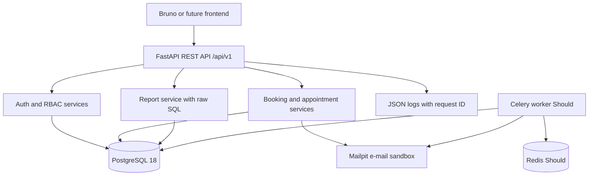

# ClinicQ appointment booking API

A backend-only FastAPI project specification for a Pune clinic appointment booking REST API.

## Quick facts

| Item | Value |
|---|---|
| Track | Web Development — Backend API |
| Difficulty | ★★★☆☆ Intermediate |
| Duration | 6 weeks, about 180 hours |
| Target job roles | Python Backend Developer, API Developer, Software Engineer (Backend) |
| Key skills | FastAPI, REST, JWT, PostgreSQL, SQLAlchemy, transactions, Docker, CI, testing |
| Prerequisites | Basic Python, basic SQL, Git basics, willingness to learn HTTP |
| Minimum hardware | 8 GB RAM laptop using the lite profile |
| Student repository name | `clinicq-api` |

## What you will build

- Patient registration, login, refresh token rotation, logout, and login lockout.
- Admin-managed doctors, specializations, fees, weekly sessions, leaves, and holidays.
- Availability lookup that subtracts leaves, active appointments, and past times.
- Patient and receptionist booking with concurrency-safe business rules.
- Appointment state flow for `BOOKED`, `CHECKED_IN`, `COMPLETED`, `CANCELLED`, and `NO_SHOW`.
- Doctor search with filters, pagination, and sorting.
- RFC 9457 Problem Details errors under `/api/v1`.
- Audit logs for every appointment status change.
- One hand-written SQL doctor performance report with revenue rank.
- A Bruno or Postman API collection for the final demo.

## Architecture at a glance

## How to read this specification

Read the documents in order for the first pass. Then keep `03-functional-requirements.md`, `08-api-specification.md`, and `09-testing-strategy-and-test-cases.md` open while coding.

MUST means mandatory for grading. SHOULD means recommended after Must scope is stable. MAY means optional. IDs connect stories, requirements, rules, tests, and demo evidence. Examples: `US-07`, `FR-BOOK-02`, `BR-13`, and `NFR-REL-01`.

## Document index

| Document | Purpose |
|---|---|
| [01 Project overview](docs/01-project-overview.md) | Problem, scope, constraints, goals, and job relevance. |
| [02 Users and roles](docs/02-users-and-roles.md) | Roles, personas, permissions, journeys, and user stories. |
| [03 Functional requirements](docs/03-functional-requirements.md) | FRs, acceptance criteria, business rules, validations, and state machine. |
| [04 Non-functional requirements](docs/04-non-functional-requirements.md) | Performance, security, privacy, reliability, observability, and portability. |
| [05 System architecture](docs/05-system-architecture.md) | Architecture diagrams, flows, deployment view, repository tree, and ADR list. |
| [06 Tech stack and setup](docs/06-tech-stack-and-setup.md) | Tools, versions, local setup, hardware profiles, and learning order. |
| [07 Data model](docs/07-data-model.md) | Logical tables, constraints, indexes, samples, and migration policy. |
| [08 API specification](docs/08-api-specification.md) | Endpoint contracts, examples, status codes, errors, pagination, and versioning. |
| [09 Testing strategy and test cases](docs/09-testing-strategy-and-test-cases.md) | Test plan, coverage thresholds, test catalog, traceability, and performance tests. |
| [10 DevOps CI/CD and quality](docs/10-devops-ci-cd-and-quality.md) | Git workflow, CI jobs, Docker, secrets, releases, and Definition of Done. |
| [11 Milestones and deliverables](docs/11-milestones-and-deliverables.md) | Six-week plan, effort budget, checklist, submission, and demo script. |
| [12 Evaluation rubric](docs/12-evaluation-rubric.md) | Mandatory gates, scoring, bonus, deductions, grade bands, and viva questions. |
| [13 Interview preparation](docs/13-interview-preparation.md) | STAR pitch, interview questions, deep dives, resume bullets, and fundamentals. |
| [14 Glossary and resources](docs/14-glossary-and-resources.md) | Term definitions, official links, free resources, and reading order. |

## Rules for students

### Individual work

You work alone. You may discuss concepts with classmates, but you must write and understand your own code, tests, ADRs, and demo.

### AI assistant policy

> You MAY use AI assistants (for example GitHub Copilot or ChatGPT) to learn concepts, explain errors, and review your code. You MUST understand every line that you commit. You MUST tell the trainer about significant AI help in the pull request description. You MUST NOT give this specification to an AI tool and submit the generated solution as your own work. In the viva, the trainer asks you to explain and change your code live. If you cannot explain your code, the result is "Rework required".

### How to ask questions

> Open a GitHub Issue in this specification repository. Start the title with `[Question]`. The trainer answers in the issue, so all students can see the answer. If the answer changes the specification, the trainer updates the change log.

### Student repository

> Create a public repository with the name `clinicq-api` in your own GitHub account. Add the trainer (`@sukurcf`) as a collaborator. Do not copy this specification into your repository. Link to it from your README.

### Review model

> Every change goes through a pull request. You MAY merge your own pull request after CI is green and you complete the PR checklist. The trainer reviews at least 2 substantive pull requests from each student every week. The trainer can ask for changes at any time.

### Requirement freeze

> This specification is frozen for the cohort. The trainer can add clarifications. If a change affects grading, the change log states the impact.

### Weekly demos

Every Friday, show a 15-minute progress demo to the trainer. Bring one working feature, one test result, and one question or risk.

## Change log

| Version | Date | Change |
|---|---|---|
| 1.0 | 2026-10-02 | First release |
