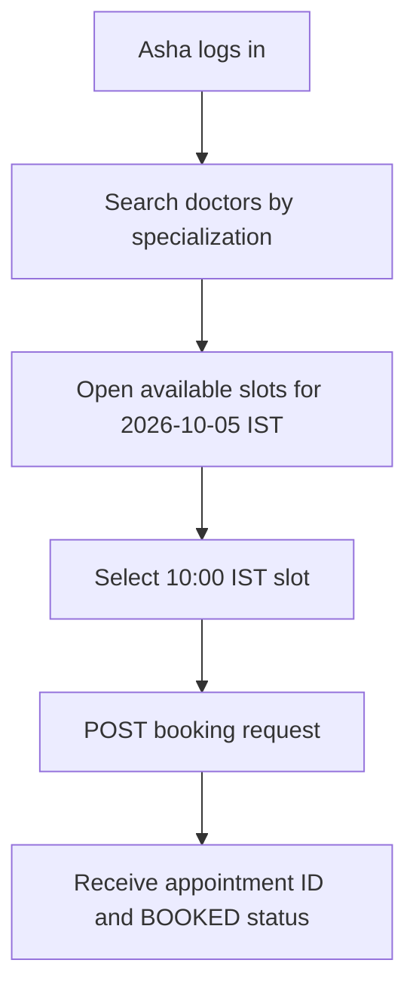
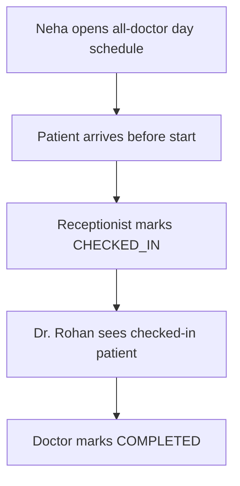
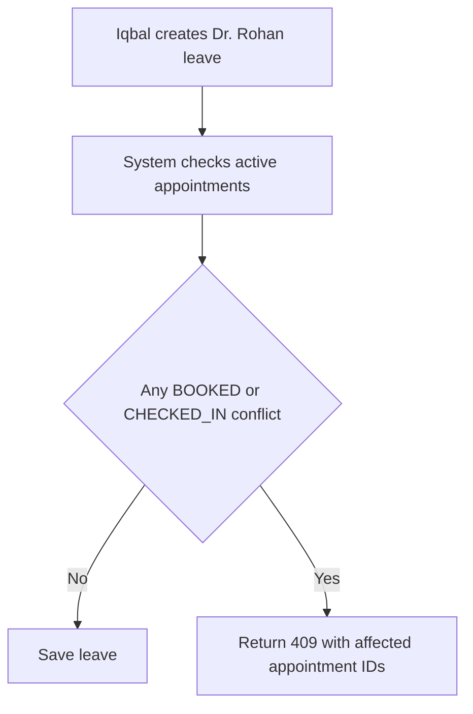

# Users and roles

Purpose: This document defines ClinicQ users, permissions, journeys, and stories that cover all Must requirements.

## Roles

| Role | Description | Main goal |
|---|---|---|
| Patient | A registered patient with a login account. | Search doctors and manage own appointments. |
| Doctor | A clinic doctor with a staff login account. | See own queue and complete consultations. |
| Receptionist | A clinic staff member who handles phone and front-desk work. | Book for patients and manage daily arrivals. |
| Admin | The clinic manager with full staff administration rights. | Maintain doctors, schedules, users, and reports. |
| Notification Worker | A system actor in Should scope. | Send e-mails and reminders without a user session. |

## Personas

| Persona | Role | Goals | Pain points | Technical comfort |
|---|---|---|---|---|
| Asha Kulkarni | Patient | Book a General Medicine visit after work and cancel early if plans change. | Phone lines are busy and paper bookings are unclear. | Comfortable with mobile apps. |
| Dr. Rohan Mehta | Doctor | See checked-in patients and close completed visits quickly. | Walk-ins and no-shows make the paper queue unreliable. | Comfortable with a simple web dashboard. |
| Neha Patil | Receptionist | Find a free slot while a patient is on the phone. | Conflict reasons are not written on paper slips. | Comfortable with search forms and filters. |
| Iqbal Shaikh | Admin | Change schedules and review doctor revenue. | Schedule changes can silently break appointments. | Comfortable with reports and CSV files. |

## Permission matrix

Legend: Allowed, Own, Staff, Admin, Public, Denied, or System.

| Endpoint group or action | Patient | Doctor | Receptionist | Admin |
|---|---|---|---|---|
| Patient registration | Public | Denied | Denied | Denied |
| Login, refresh, logout | Allowed | Allowed | Allowed | Allowed |
| Patient profile read or update | Own | Denied | Denied | Denied |
| Staff account creation and deactivation | Denied | Denied | Denied | Admin |
| Doctor create, update, deactivate | Denied | Denied | Denied | Admin |
| Specialization management | Denied | Denied | Denied | Admin |
| Weekly sessions, leaves, holidays | Denied | Denied | Denied | Admin |
| Doctor search | Allowed | Allowed | Allowed | Allowed |
| Availability lookup | Allowed | Allowed | Allowed | Allowed |
| Book own appointment | Own | Denied | Denied | Denied |
| Book for registered patient | Denied | Denied | Staff | Admin |
| View own upcoming and past appointments | Own | Denied | Denied | Denied |
| Cancel own appointment | Own, at least 2 hours before start | Denied | Denied | Denied |
| Staff cancel appointment | Denied | Denied | Staff, before start | Admin, before start |
| Check in appointment | Denied | Denied | Staff | Admin |
| Mark no-show | Denied | Denied | Staff | Admin |
| Mark completed | Denied | Own doctor only | Denied | Denied |
| Own doctor day schedule | Denied | Own | Denied | Denied |
| All doctors day schedule | Denied | Denied | Staff | Admin |
| Doctor performance report | Denied | Denied | Denied | Admin |
| Audit log read for appointment | Denied | Denied | Staff | Admin |
| Health liveness | Public | Public | Public | Public |
| Health readiness | Public | Public | Public | Public |
| OpenAPI documentation | Allowed in local/dev | Allowed in local/dev | Allowed in local/dev | Allowed in local/dev |
| Seed command | Denied | Denied | Denied | Admin in local/dev only |

The Notification Worker may read due reminders and e-mail templates in Should scope. It MUST NOT create, cancel, or complete appointments.

## Key user journeys

### Patient booking journey

### Front-desk arrival journey

### Admin schedule-change journey

## User stories

| ID | Story | Linked FR IDs |
|---|---|---|
| US-01 | As a patient, I want to register with e-mail and password, so that I can use ClinicQ without calling the desk. | FR-AUTH-01 |
| US-02 | As any user, I want secure login and token refresh, so that my session remains safe and short-lived. | FR-AUTH-02, FR-AUTH-03 |
| US-03 | As an admin, I want to create and deactivate staff accounts, so that only clinic staff can use staff functions. | FR-AUTH-04 |
| US-04 | As an admin, I want to maintain doctor profiles and specializations, so that search results are current. | FR-DOC-01 |
| US-05 | As an admin, I want to maintain weekly sessions and leaves, so that availability matches real clinic hours. | FR-DOC-02 |
| US-06 | As a patient, I want free slots for a doctor and date, so that I can choose a valid future time. | FR-AVAIL-01 |
| US-07 | As a patient, I want to book a free slot, so that I get an appointment ID. | FR-BOOK-01, FR-BOOK-02 |
| US-08 | As a receptionist, I want to book for a registered caller, so that phone booking uses the same rules. | FR-BOOK-01, FR-BOOK-02, FR-APPT-03 |
| US-09 | As a patient, I want to see upcoming and past appointments, so that I can track visits. | FR-APPT-02 |
| US-10 | As a patient, I want to cancel at least 2 hours before the start, so that the slot can be reused. | FR-APPT-01, FR-APPT-02 |
| US-11 | As a receptionist, I want to check in or mark no-show, so that the day queue is accurate. | FR-APPT-01, FR-APPT-03 |
| US-12 | As a doctor, I want to view my day schedule and complete appointments, so that visit status is correct. | FR-APPT-01, FR-APPT-04 |
| US-13 | As any user, I want doctor search with filters and pagination, so that result pages are fast and predictable. | FR-SEARCH-01 |
| US-14 | As a frontend developer, I want one error format and ISO timestamps, so that client code is simple. | FR-API-01 |
| US-15 | As an operator, I want health checks, migrations, seed data, and request logs, so that the API is demo-ready. | FR-OPS-01 |
| US-16 | As an auditor, I want every status change recorded, so that appointment disputes can be traced. | FR-AUDIT-01 |
| US-17 | As an admin, I want doctor performance reports, so that I can compare revenue and no-shows. | FR-REPORT-01 |
| US-18 | As a student demoing the project, I want an API collection, so that I can show all important flows. | FR-CLIENT-01 |
| US-19 | As a patient, I want booking and cancellation e-mails, so that I have a record outside the app. | FR-NOTIF-01 |
| US-20 | As a patient, I want a reminder 24 hours before the visit, so that I do not miss the appointment. | FR-NOTIF-02 |
| US-21 | As an admin, I want optional advanced features after Must scope, so that I can improve the portfolio safely. | FR-DOC-03, FR-PAT-01, FR-CLIN-01, FR-REPORT-02, FR-API-02, FR-PERF-01, FR-APPT-05, FR-WAIT-01, FR-TECH-01, FR-TEST-01, FR-DEPLOY-01 |

[Back to README](../README.md)
