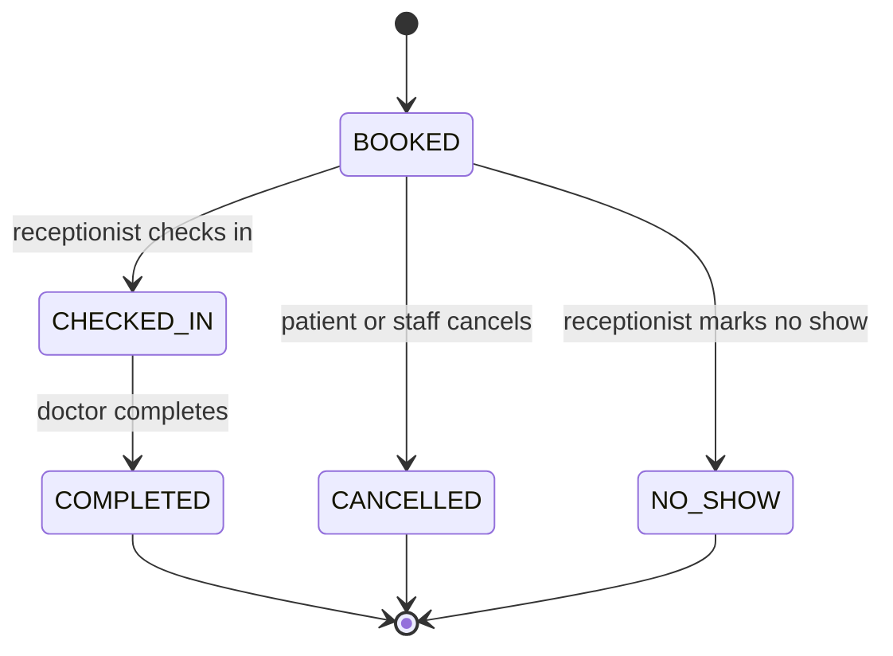

# Functional requirements

Purpose: This document defines ClinicQ functions, business rules, state machines, validations, and error responses.

## Functional requirement summary

| ID | Title | Priority | Roles | Linked BRs |
|---|---|---|---|---|
| FR-AUTH-01 | Patient self-registration | Must | Patient | BR-01, BR-02 |
| FR-AUTH-02 | Login and lockout | Must | Patient, Doctor, Receptionist, Admin | BR-01, BR-03 |
| FR-AUTH-03 | Refresh rotation and logout | Must | Patient, Doctor, Receptionist, Admin | BR-04 |
| FR-AUTH-04 | Staff accounts and RBAC | Must | Admin | BR-05 |
| FR-DOC-01 | Doctor profile and specialization management | Must | Admin | BR-06 |
| FR-DOC-02 | Weekly sessions, leaves, and holidays | Must | Admin | BR-07, BR-08 |
| FR-AVAIL-01 | Availability slots | Must | Patient, Doctor, Receptionist, Admin | BR-07, BR-09, BR-10 |
| FR-BOOK-01 | Appointment booking | Must | Patient, Receptionist, Admin | BR-09, BR-10, BR-11, BR-12, BR-13 |
| FR-BOOK-02 | Concurrency protection | Must | Patient, Receptionist, Admin | BR-10, BR-11, BR-12, BR-13 |
| FR-APPT-01 | Appointment state machine | Must | Patient, Doctor, Receptionist, Admin | BR-14, BR-15, BR-16 |
| FR-APPT-02 | Patient appointment actions | Must | Patient | BR-14, BR-15 |
| FR-APPT-03 | Receptionist operations | Must | Receptionist, Admin | BR-14, BR-16 |
| FR-APPT-04 | Doctor appointment actions | Must | Doctor | BR-14 |
| FR-SEARCH-01 | Doctor search | Must | Patient, Doctor, Receptionist, Admin | BR-17 |
| FR-API-01 | API standards and errors | Must | All roles | BR-18 |
| FR-OPS-01 | Health, migrations, fixtures, logs, and local lifecycle | Must | Public health, Student | BR-19, BR-31 |
| FR-AUDIT-01 | Appointment audit log | Must | System, Receptionist, Admin | BR-20 |
| FR-REPORT-01 | Doctor performance report | Must | Admin | BR-21 |
| FR-CLIENT-01 | Local API collection or Python HTTP demonstration | Must | Admin, Student | BR-22 |
| FR-NOTIF-01 | Booking and cancellation e-mail | Should | Patient, Worker | BR-23 |
| FR-NOTIF-02 | Reminder e-mail | Should | Patient, Worker | BR-24 |
| FR-DOC-03 | Variable slot length | Should | Admin | BR-25 |
| FR-PAT-01 | Walk-in patients | Should | Receptionist | BR-26 |
| FR-CLIN-01 | Notes and prescriptions | Should | Doctor, Patient | BR-27 |
| FR-REPORT-02 | Extra reports and CSV export | Should | Admin | BR-21 |
| FR-API-02 | Expanded API error-contract regressions | Should | Student | BR-18 |
| FR-PERF-01 | Locust load target | Should | Student | BR-28 |
| FR-APPT-05 | Atomic reschedule | Could | Patient, Receptionist, Admin | BR-10, BR-14 |
| FR-WAIT-01 | Waitlist | Could | Patient, Worker | BR-29 |
| FR-TECH-01 | Async SQLAlchemy or Redis cache | Could | Student | BR-30 |
| FR-TEST-01 | Schemathesis contract tests | Could | Student | BR-18 |

## Must functional requirements

### FR-AUTH-01 — Patient self-registration

Description: ClinicQ MUST let a patient create a login account with e-mail and password. The API MUST create a linked patient profile in the same transaction. The password hash MUST use Argon2 or bcrypt. Staff accounts MUST NOT be created through this endpoint.

Priority: Must. Roles: Patient. Linked BRs: BR-01, BR-02.

Acceptance criteria:

- Given `asha.kulkarni@example.in`, password `ClinicQ#2026`, full name `Asha Kulkarni`, and phone `9876543210`, when the patient registers, then the API returns HTTP 201 and a patient profile ID.
- Given an existing e-mail `asha.kulkarni@example.in`, when the patient registers again, then the API returns HTTP 409 with Problem Details type `email-already-registered`.
- Given password `short`, when the patient registers, then the API returns HTTP 422 with field `password` and code `password-policy-failed`.

### FR-AUTH-02 — Login and lockout

Description: ClinicQ MUST return a JWT access token and a refresh token after a valid login. The access token lifetime is 15 minutes. Five failed logins in 15 minutes MUST lock the account for 15 minutes. Locked accounts MUST receive HTTP 429.

Priority: Must. Roles: Patient, Doctor, Receptionist, Admin. Linked BRs: BR-01, BR-03.

Acceptance criteria:

- Given valid credentials for `asha.kulkarni@example.in`, when login succeeds, then the response contains `access_token`, `refresh_token`, `token_type` `bearer`, and `expires_in` 900.
- Given 5 wrong-password attempts for the same e-mail between 10:00 and 10:15 IST, when the sixth login is attempted at 10:14 IST, then the API returns HTTP 429 with type `account-temporarily-locked` and `lockout_until`.
- Given the lockout expires at 10:30 IST, when valid credentials are submitted at 10:31 IST, then login returns HTTP 200 and clears the failed-attempt counter.

### FR-AUTH-03 — Refresh rotation and logout

Description: Refresh tokens MUST live for 7 days and MUST rotate on every successful refresh. Raw refresh tokens MUST never be stored. Logout MUST revoke the presented refresh token. Reuse or revocation attempts MUST be treated as security events.

Priority: Must. Roles: Patient, Doctor, Receptionist, Admin. Linked BRs: BR-04.

Acceptance criteria:

- Given a valid refresh token issued on 2026-10-02, when refresh is called before 2026-10-09, then the API returns HTTP 200 with a new access token and a new refresh token.
- Given the same refresh token is presented a second time after it was rotated, when refresh is called, then the API returns HTTP 401 with type `refresh-token-reused`, revokes the token family, and requires full login.
- Given a refresh token revoked by logout, when refresh is called, then the API returns HTTP 401 with type `refresh-token-revoked` and does not issue tokens.

### FR-AUTH-04 — Staff accounts and RBAC

Description: Admins MUST create, list, and deactivate doctor, receptionist, and admin login accounts. Role checks MUST run for every protected endpoint group. Deactivated staff MUST be unable to log in, refresh, or use existing access tokens.

Priority: Must. Roles: Admin. Linked BRs: BR-05.

Acceptance criteria:

- Given admin `iqbal.shaikh@example.in`, when he creates receptionist `neha.patil@example.in`, then the API returns HTTP 201 and role `RECEPTIONIST`.
- Given admin deactivates `neha.patil@example.in`, when the request succeeds, then the API returns HTTP 200 and `is_active` is false.
- Given a patient token, when it calls an admin doctor endpoint, then the API returns HTTP 403 with type `permission-denied`.
- Given a deactivated doctor account, when an unexpired access token is used, then the API returns HTTP 401 with type `account-deactivated`.

### FR-DOC-01 — Doctor profile and specialization management

Description: Admins MUST create, read, update, and deactivate doctor profiles. A doctor profile MUST have a specialization and consultation fee in INR. Deactivation MUST keep historical appointments. Deactivated doctors MUST be excluded from public search and new bookings.

Priority: Must. Roles: Admin. Linked BRs: BR-06.

Acceptance criteria:

- Given `Dr. Rohan Mehta`, specialization `General Medicine`, and fee `600.00`, when admin creates a doctor, then the API returns HTTP 201 with `active` true.
- Given doctor `D-100` has no future active appointments, when admin deactivates the doctor, then new availability queries for `D-100` return HTTP 404 with type `doctor-not-active`.
- Given fee `-10`, when admin updates a doctor, then the API returns HTTP 422 with code `fee-must-be-non-negative`.

### FR-DOC-02 — Weekly sessions, leaves, and holidays

Description: Admins MUST define 1 or 2 weekly sessions for each weekday. Sessions on one weekday MUST NOT overlap. Leaves and holidays MUST remove intersecting slots from availability. A schedule or leave change that conflicts with active appointments MUST be rejected with HTTP 409 and affected appointment IDs.

Priority: Must. Roles: Admin. Linked BRs: BR-07, BR-08.

Acceptance criteria:

- Given Monday sessions `09:00-13:00` and `17:00-20:00` IST for `D-100`, when admin saves the schedule, then the API returns HTTP 200.
- Given appointment `A-300` is `BOOKED` at 2026-10-05 10:00 IST, when admin adds leave covering that time, then the API returns HTTP 409 with type `schedule-change-conflicts` and `affected_appointment_ids` containing `A-300`.
- Given three sessions for Tuesday, when admin saves the schedule, then the API returns HTTP 422 with code `too-many-sessions-for-weekday`.
- Given Tuesday sessions `09:00-12:00` and `11:30-14:00` IST, when admin saves the schedule, then the API returns HTTP 422 with code `sessions-overlap`.

### FR-AVAIL-01 — Availability slots

Description: ClinicQ MUST calculate free slots for one doctor and date. Slot starts are anchored to each session start in 15-minute steps. A slot end MUST be no later than the session end. Free slots equal weekly schedule minus half-open leaves, active appointments, and past times. Stored times MUST be UTC. Responses MUST show Asia/Kolkata offsets.

Priority: Must. Roles: Patient, Doctor, Receptionist, Admin. Linked BRs: BR-07, BR-09, BR-10.

Acceptance criteria:

- Given Dr. Rohan has Monday `09:00-10:00` IST and one active booking at `09:15`, when availability is requested for 2026-10-05, then returned slots include `09:00`, `09:30`, and `09:45` IST only.
- Given current time is 2026-10-05 09:20 IST, when availability is requested for the same date, then slots before 09:20 IST are omitted.
- Given a leave interval `[10:00, 10:15)` IST, when availability is calculated, then the 09:45 slot remains and the 10:00 slot is blocked.
- Given date 31 days ahead, when availability is requested, then the API returns HTTP 422 with type `booking-window-exceeded`.

### FR-BOOK-01 — Appointment booking

Description: Patients MUST book for themselves, and the API derives `patient_id` from their token. Receptionists and admins MUST send `patient_id` for a registered patient. The booking start MUST be strictly after now and no later than now plus 30 days. It MUST be on schedule, outside half-open leave, and free among active appointments.

Priority: Must. Roles: Patient, Receptionist, Admin. Linked BRs: BR-09, BR-10, BR-11, BR-12, BR-13.

Acceptance criteria:

- Given patient Asha has 0 upcoming active appointments, when she books Dr. Rohan at 2026-10-05 10:00 IST, then the API returns HTTP 201 and status `BOOKED`.
- Given Asha books as a Patient, when the body omits `patient_id`, then the API uses Asha's token profile as the patient.
- Given Neha books as Receptionist without `patient_id`, when she submits the request, then the API returns HTTP 422 with field `patient_id`.
- Given an active appointment already exists for Dr. Rohan at 2026-10-05 10:00 IST, when another patient books that slot, then the API returns HTTP 409 with type `slot-already-booked`.
- Given Asha already has 3 upcoming active appointments, when she books any fourth upcoming slot, then the API returns HTTP 409 with type `booking-limit-reached` and creates no appointment.

### FR-BOOK-02 — Concurrency protection

Description: All booking rules MUST hold under concurrent requests. Students MUST record the chosen strategy in an ADR. Acceptable strategies include database constraints, row locks, or SERIALIZABLE isolation with retry. The implementation MUST not rely only on in-memory checks.

Priority: Must. Roles: Patient, Receptionist, Admin. Linked BRs: BR-10, BR-11, BR-12, BR-13.

Acceptance criteria:

- Given 10 parallel booking requests for Dr. Rohan at the same future slot, when they run together, then exactly 1 returns HTTP 201 and exactly 9 return HTTP 409 with type `slot-already-booked`.
- Given one patient has 0 upcoming appointments and sends 5 parallel booking requests for different slots, when they run together, then at most 3 return HTTP 201 and the rest return HTTP 409 with type `booking-limit-reached`.
- Given appointment `A-300` is cancelled, when another patient books the same doctor and start time, then the API returns HTTP 201.

### FR-APPT-01 — Appointment state machine

Description: Appointment status changes MUST follow the state machine in this document. Invalid transitions MUST be rejected. The actor, reason, previous status, new status, and timestamp MUST be auditable.

Priority: Must. Roles: Patient, Doctor, Receptionist, Admin. Linked BRs: BR-14, BR-15, BR-16.

Acceptance criteria:

- Given appointment `A-300` is `BOOKED`, when receptionist checks in the patient, then status becomes `CHECKED_IN` and an audit row is created.
- Given appointment `A-300` is `CHECKED_IN`, when the assigned doctor marks completed, then status becomes `COMPLETED` and an audit row is created.
- Given appointment `A-300` is `CANCELLED`, when any user tries to check in, then the API returns HTTP 409 with type `invalid-status-transition`.

### FR-APPT-02 — Patient appointment actions

Description: Patients MUST view their upcoming and past appointments. Patients MUST cancel only their own `BOOKED` appointments at least 2 hours before the start. Cancelled appointments MUST free the slot for booking.

Priority: Must. Roles: Patient. Linked BRs: BR-14, BR-15.

Acceptance criteria:

- Given Asha has appointments on 2026-10-05 and 2026-09-20, when she requests her list on 2026-10-02, then the API separates upcoming and past records.
- Given Asha has a `BOOKED` appointment at 18:00 IST, when she cancels at 15:59 IST, then status becomes `CANCELLED`.
- Given Asha tries to cancel at 16:30 IST for an 18:00 IST start, then the API returns HTTP 409 with type `cancellation-window-closed`.

### FR-APPT-03 — Receptionist operations

Description: Receptionists MUST book for registered patients, check in arrivals, mark no-shows, staff-cancel future `BOOKED` appointments, and see the schedule for all doctors on a date. No-show marking is allowed at least 15 minutes after the appointment start.

Priority: Must. Roles: Receptionist, Admin. Linked BRs: BR-14, BR-16.

Acceptance criteria:

- Given today is 2026-10-05, when Neha opens the all-doctor schedule, then the API returns appointments grouped by doctor and start time.
- Given a `BOOKED` appointment starts at 10:00 IST, when receptionist marks no-show at 10:16 IST, then status becomes `NO_SHOW`.
- Given receptionist marks no-show at 10:10 IST for a 10:00 IST appointment, then the API returns HTTP 409 with type `no-show-too-early`.

### FR-APPT-04 — Doctor appointment actions

Description: Doctors MUST see only their own day schedule. Doctors MUST mark only their own checked-in appointments as completed. Doctors MUST NOT cancel patient appointments.

Priority: Must. Roles: Doctor. Linked BRs: BR-14.

Acceptance criteria:

- Given Dr. Rohan is authenticated, when he requests 2026-10-05 schedule, then only appointments assigned to Dr. Rohan are returned.
- Given Dr. Rohan completes his own `CHECKED_IN` appointment, then the API returns HTTP 200 and status `COMPLETED`.
- Given Dr. Rohan tries to complete Dr. Nair appointment, then the API returns HTTP 403 with type `permission-denied`.

### FR-SEARCH-01 — Doctor search

Description: Users MUST search active doctors by specialization, partial case-insensitive name, and availability on a date. Search MUST support `limit`, `offset`, and sorting. The maximum limit is 100.

Priority: Must. Roles: Patient, Doctor, Receptionist, Admin. Linked BRs: BR-17.

Acceptance criteria:

- Given query `specialization=General Medicine&name=roh`, when search runs, then active `Dr. Rohan Mehta` is returned.
- Given `available_on=2026-10-05`, when search runs, then only active doctors with at least one free future slot that day are returned.
- Given `limit=101`, when search runs, then the API returns HTTP 422 with type `pagination-limit-exceeded`.

### FR-API-01 — API standards and errors

Description: Product endpoints MUST use the `/api/v1` prefix. The API MUST publish OpenAPI documentation. Errors MUST use RFC 9457 Problem Details. Timestamps MUST use ISO 8601.

Priority: Must. Roles: All roles. Linked BRs: BR-18.

Acceptance criteria:

- Given a validation failure, when the API returns an error, then the body contains `type`, `title`, `status`, `detail`, `instance`, and optional `errors`.
- Given an appointment response, when `starts_at` is shown, then the timestamp is ISO 8601 and includes `+05:30` for display fields.
- Given an unknown route outside `/api/v1`, when it is requested, then the API returns HTTP 404 with type `not-found`.

### FR-OPS-01 — Health, migrations, fixtures, logs, and local lifecycle

Description: ClinicQ MUST expose public liveness/readiness under `/api/v1/health`, use Alembic migrations and an idempotent fictional seed command, and emit structured JSON logs with request IDs. The student MUST implement document 06's single local start/stop and explicitly confirmed reset. After initial downloads, local API operations and runtime tests MUST use cached dependencies/images and recorded fixtures, not external services.

Priority: Must. Roles: Public liveness and readiness, Student. Linked BRs: BR-19, BR-31.

Acceptance criteria:

- Given the API process is running, when `/api/v1/health/live` is requested, then the API returns HTTP 200 without a database query.
- Given the database is unavailable, when `/api/v1/health/ready` is requested, then the API returns HTTP 503 with type `database-not-ready`.
- Given the seed command runs in local/dev, then it creates 5 doctors, 20 patients, and 2 weeks of schedules.
- Given a clean implementation clone and empty local volumes, when the start entry point runs after dependency downloads, then migrations, seed records, and both exact health responses are available on loopback.
- Given recorded local fixtures and external egress disabled, when a Python test requests fresh seeded Rohan availability for the saved demo date, then the API returns exactly four 15-minute slots from `09:00` through `09:45` IST.
- Given an appointment, audit history, and refresh-token family exist, when local stop then start runs, then the same IDs, states, audit count, token records, and signing configuration remain.
- Given invalid input, unavailable PostgreSQL, or an occupied API port, when the applicable API/start command runs, then it gives the documented Problem Details or nonzero startup diagnostic without partial writes or data deletion.

### FR-AUDIT-01 — Appointment audit log

Description: ClinicQ MUST write an audit log for every appointment status change. The log MUST capture who changed the status, when it changed, previous status, new status, and reason. Audit rows MUST not be edited by normal API endpoints.

Priority: Must. Roles: System, Staff. Linked BRs: BR-20.

Acceptance criteria:

- Given a receptionist changes `BOOKED` to `CHECKED_IN`, when the transaction commits, then one audit row is stored with actor role `RECEPTIONIST`.
- Given a doctor changes `CHECKED_IN` to `COMPLETED`, when the transaction commits, then one audit row stores both statuses and `changed_at` in UTC.
- Given a normal API client attempts to update an audit row, then no endpoint exists for that update.

### FR-REPORT-01 — Doctor performance report

Description: Admins MUST run one date-range doctor performance report using hand-written SQL. The report MUST include appointments, completed count, no-show count, revenue, and revenue rank. Revenue is the sum of `fee_at_booking_inr` for completed appointments whose start falls within the inclusive IST date range. Counts include all statuses in the range. Revenue rank uses standard rank ties, such as 1, 1, 3. The student MUST keep EXPLAIN ANALYZE evidence for this report.

Priority: Must. Roles: Admin. Linked BRs: BR-21.

Acceptance criteria:

- Given date range 2026-10-01 to 2026-10-31, when admin requests the report, then each doctor row includes `appointments`, `completed`, `no_shows`, `revenue_inr`, and `revenue_rank`.
- Given an appointment was booked at INR 600 and Dr. Rohan later changes fee to INR 700, when the completed appointment appears in the report, then revenue uses INR 600.
- Given a receptionist token, when it requests the report, then the API returns HTTP 403 with type `permission-denied`.
- Given `to_date` is before `from_date`, when admin requests the report, then the API returns HTTP 422 with type `invalid-date-range`.
- Given the report query is finalized, then the student stores EXPLAIN ANALYZE evidence in the student repository documentation.

### FR-CLIENT-01 — Local API collection or Python HTTP demonstration

Description: The student MUST provide either a local Bruno/Postman collection or a Python HTTP demonstration with assertions. It MUST cover auth, search, availability, booking, state changes, admin schedule conflict, report, and health. Use local environment variables and generated credentials; no interface implementation is allowed.

Priority: Must. Roles: Student, Admin. Linked BRs: BR-22.

Acceptance criteria:

- Given a clean seeded local run, when the selected API demonstration runs, then auth, search, availability, and one booking request succeed with exact status/body assertions.
- Given the demonstration's admin schedule-conflict request, when it runs against its isolated booking fixture, then the API returns HTTP 409 with type `schedule-change-conflicts`.
- Given demo variables and saved response evidence are inspected, then they contain no committed credentials, raw tokens, or real personal data.

## Should and Could functional requirements

| ID | Requirement | Acceptance criteria |
|---|---|---|
| FR-NOTIF-01 | Send local e-mail on booking and cancellation through Mailpit. | Booking returns 201 and one e-mail is captured by local Mailpit with appointment ID; cancellation creates one cancellation e-mail. |
| FR-NOTIF-02 | Send local reminder e-mail 24 hours before start through Celery and Redis. | One reminder outbox row exists per appointment, retries skip sent rows, and ambiguous SMTP sends may duplicate e-mail. |
| FR-DOC-03 | Allow doctor slot length 10, 15, 20, or 30 minutes. | Admin saves 20 minutes successfully; 25 minutes returns HTTP 422 with `invalid-slot-length`. |
| FR-PAT-01 | Allow receptionist to create walk-in patient records without login. | Walk-in has no user account and can be booked by receptionist. |
| FR-CLIN-01 | Allow doctor notes and prescription text. | Doctor writes notes after check-in; patient can read own notes after completion. |
| FR-REPORT-02 | Add appointments per doctor per day, no-show rate, and CSV export. | Admin downloads CSV with header row and date-range filters. |
| FR-API-02 | Add parameterized error-contract regressions and OpenAPI examples for selected Should/Could endpoints. | Documented 401/403/409/422 errors retain type/status/request ID; no stack trace, raw token, or other patient's data appears. |
| FR-PERF-01 | Run Locust availability load test. | p95 is below 300 ms at 50 concurrent users with seed data. |
| FR-APPT-05 | Reschedule as one atomic operation. | Old slot is freed and new slot is booked in one transaction, or neither change occurs. |
| FR-WAIT-01 | Add waitlist for a full slot. | First waitlisted patient is notified when a slot is cancelled. |
| FR-TECH-01 | Use async SQLAlchemy or Redis availability cache. | ADR explains choice and invalidation or transaction behavior. |
| FR-TEST-01 | Add Schemathesis contract testing. | Contract run covers documented `/api/v1` endpoints and fails on undocumented 500 errors. |

## Business rules

| BR ID | Exact rule | Exact values | Used by |
|---|---|---|---|
| BR-01 | Login accounts require unique e-mail and hashed passwords. | Argon2 or bcrypt; no raw passwords stored. | FR-AUTH-01, FR-AUTH-02 |
| BR-02 | Patient self-registration creates only `PATIENT` role accounts. | Staff roles are `DOCTOR`, `RECEPTIONIST`, `ADMIN`. | FR-AUTH-01 |
| BR-03 | Login throttling locks after failed attempts. | 5 failures in 15 minutes cause 15-minute lockout; HTTP 429. | FR-AUTH-02 |
| BR-04 | Refresh tokens rotate and are revocable. | Access 15 minutes; refresh 7 days; reused token returns `refresh-token-reused`; revoked token returns `refresh-token-revoked`. | FR-AUTH-03 |
| BR-05 | Role-based access control applies to every endpoint group. | Roles: Patient, Doctor, Receptionist, Admin. | FR-AUTH-04 |
| BR-06 | Doctor profiles need active state and INR fee. | Fee is INR decimal, non-negative. | FR-DOC-01 |
| BR-07 | Weekly sessions define possible slots. | 1 or 2 non-overlapping sessions per weekday; end after start. Slots start at the session start in 15-minute steps and end no later than the session end. | FR-DOC-02, FR-AVAIL-01 |
| BR-08 | Conflicting schedule or leave changes are rejected. | HTTP 409 and affected active appointment IDs. | FR-DOC-02 |
| BR-09 | Slot booking window is limited. | Start is strictly after now and no later than now plus 30 days. | FR-AVAIL-01, FR-BOOK-01 |
| BR-10 | Active appointments block slots. | Active statuses are `BOOKED` and `CHECKED_IN`; cancelled slots can be reused. | FR-AVAIL-01, FR-BOOK-01, FR-BOOK-02 |
| BR-11 | One patient-doctor-date active appointment is allowed. | Maximum 1 active appointment for each patient with each doctor on an IST date. | FR-BOOK-01, FR-BOOK-02 |
| BR-12 | Upcoming active patient appointments are limited. | Maximum 3 upcoming active appointments per patient. | FR-BOOK-01, FR-BOOK-02 |
| BR-13 | Booking rules must be concurrency-safe. | Database constraint, row locks, or SERIALIZABLE isolation with retry; ADR required. | FR-BOOK-01, FR-BOOK-02 |
| BR-14 | Appointment transitions are restricted. | `BOOKED` to `CHECKED_IN`, `CANCELLED`, or `NO_SHOW`; `CHECKED_IN` to `COMPLETED`. | FR-APPT-01, FR-APPT-02, FR-APPT-03, FR-APPT-04 |
| BR-15 | Patient cancellation window is strict. | Patient cancels only `BOOKED` and at least 2 hours before start. | FR-APPT-01, FR-APPT-02 |
| BR-16 | No-show timing is strict. | Receptionist marks `NO_SHOW` at least 15 minutes after start. | FR-APPT-01, FR-APPT-03 |
| BR-17 | Search paging has a maximum. | `limit` maximum 100; offset is 0 or more. | FR-SEARCH-01 |
| BR-18 | API format is stable. | `/api/v1`, RFC 9457, ISO 8601 timestamps. | FR-API-01, FR-API-02, FR-TEST-01 |
| BR-19 | Operations endpoints and fictional fixtures are local-demo ready. | Liveness 200 without DB; readiness checks DB; seed creates 5 doctors, 20 patients, 2 weeks schedules, and at least 100 appointments without occupying the reserved demo slots. | FR-OPS-01 |
| BR-20 | Status changes are audited. | Who, when, from, to, reason, appointment ID. | FR-AUDIT-01 |
| BR-21 | Admin report uses SQL depth. | Inclusive IST date range, counts by status, revenue from booking-time fee for completed appointments, rank by revenue. | FR-REPORT-01, FR-REPORT-02 |
| BR-22 | The selected local API demonstration covers critical flows. | API collection or Python HTTP assertions for auth, search, availability, booking, state changes, conflict, report, health. | FR-CLIENT-01 |
| BR-23 | Booking and cancellation e-mail are at-least-once. | Mailpit locally; no exactly-once claim. | FR-NOTIF-01 |
| BR-24 | Reminders use an outbox key. | 24 hours before appointment; one outbox row per appointment; delivery is at-least-once; duplicate e-mail is possible after ambiguous SMTP success. | FR-NOTIF-02 |
| BR-25 | Variable slot length values are limited. | 10, 15, 20, or 30 minutes. | FR-DOC-03 |
| BR-26 | Walk-in patients have no login account. | Patient record exists; user link is null. | FR-PAT-01 |
| BR-27 | Notes are visit-scoped. | Doctor writes; patient reads own completed appointment notes. | FR-CLIN-01 |
| BR-28 | Should performance target is defined. | Availability p95 below 300 ms at 50 concurrent users. | FR-PERF-01 |
| BR-29 | Waitlist notification order is FIFO. | First waitlisted patient is notified first. | FR-WAIT-01 |
| BR-30 | Cache invalidation must be safe. | Booking, cancellation, schedule, and leave changes invalidate availability cache. | FR-TECH-01 |
| BR-31 | Local lifecycle is loopback-only, persistent, and offline after downloads. | Fixed ports/named volumes in document 06; stop preserves data and secrets; seed never overwrites edits on restart; reset requires `--confirm-delete-local-data`. | FR-OPS-01 |

## Appointment state machine

| From | Event | Guard | To | Actor |
|---|---|---|---|---|
| New | Book slot | Slot is valid and all booking limits pass | BOOKED | Patient, Receptionist, Admin |
| BOOKED | Check in | Appointment is not cancelled and patient arrives | CHECKED_IN | Receptionist, Admin |
| CHECKED_IN | Complete | Actor is assigned doctor | COMPLETED | Doctor |
| BOOKED | Cancel by patient | At least 2 hours before start | CANCELLED | Patient |
| BOOKED | Cancel by staff | Before start | CANCELLED | Receptionist, Admin |
| BOOKED | Mark no-show | At least 15 minutes after start | NO_SHOW | Receptionist, Admin |

## Validation rules

| Field | Rule | Error message or code |
|---|---|---|
| `email` | Valid e-mail and unique for login accounts | `email-already-registered` |
| `password` | At least 10 characters with letter, number, and symbol | `password-policy-failed` |
| `role` | One of `PATIENT`, `DOCTOR`, `RECEPTIONIST`, `ADMIN` | `invalid-role` |
| `consultation_fee_inr` | Decimal greater than or equal to 0 | `fee-must-be-non-negative` |
| `specialization_id` | Must refer to an active specialization when creating a doctor | `specialization-not-active` |
| `session_number` | 1 or 2 for each weekday | `too-many-sessions-for-weekday` |
| weekday sessions | Sessions for one doctor and weekday MUST NOT overlap | `sessions-overlap` |
| `starts_at` | Strictly after now and no later than now plus 30 days | `booking-start-in-past` or `booking-window-exceeded` |
| `slot_start` | Aligned to slot length | `slot-not-aligned` |
| requested slot | Start must be inside a weekly session and outside leave | `slot-not-on-schedule` for off-schedule; `slot-not-available` for leave |
| `date` | ISO date in clinic display time zone | `invalid-date` |
| report date range | `to_date` must be on or after `from_date` | `invalid-date-range` |
| `limit` | Integer from 1 to 100 | `pagination-limit-exceeded` |
| `status` | Valid transition only | `invalid-status-transition` |
| `reason` | Required for cancellation and no-show | `reason-required` |

## Error scenarios

| Condition | System response | User-visible message or status |
|---|---|---|
| Slot already has active appointment | HTTP 409 Problem Details type `slot-already-booked` | This slot is already booked. |
| Slot start is outside the weekly session | Validation returns status 422 with `slot-not-on-schedule`. | This slot is not on the doctor schedule. |
| Slot start is now or in the past | Validation returns status 422 with `booking-start-in-past`. | Choose a future slot. |
| Slot intersects leave | Booking returns status 409 with `slot-not-available`. | This slot is not available. |
| Patient has 3 upcoming active appointments | Booking service returns status 409 with `booking-limit-reached`. | Patient already has 3 upcoming appointments. |
| Patient already booked same doctor on same IST date | Daily doctor guard returns status 409 with `patient-doctor-date-limit-reached`. | Patient already has an active appointment with this doctor today. |
| Account locked by login failures | Login returns status 429 with `account-temporarily-locked`. | Account is locked for 15 minutes. |
| Refresh token already used | Refresh returns status 401 with `refresh-token-reused` and revokes the token family. | Please log in again. |
| Refresh token revoked by logout | Refresh rejects the token with status 401 and `refresh-token-revoked`. | Please log in again. |
| Schedule change affects active appointments | Schedule write returns status 409 with `schedule-change-conflicts` and appointment IDs. | Resolve affected appointments first. |
| Patient cancels too late | Cancellation guard returns status 409 with `cancellation-window-closed`. | Patient cancellation closes 2 hours before start. |
| No-show attempted too early | No-show guard returns status 409 with `no-show-too-early`. | No-show can be marked 15 minutes after start. |
| Unauthorized endpoint group | Authorization dependency returns status 403 with `permission-denied`. | You do not have access to this action. |
| Bad credentials | Login fails with status 401 and type `invalid-credentials`. | Check the e-mail and password. |
| Expired access token | Protected routes return status 401 and type `token-expired`. | Please refresh or log in again. |
| Tampered or unknown access token | Token validation returns status 401 and type `invalid-token`. | Please log in again. |
| Deactivated account uses token | Active-user check returns status 401 and type `account-deactivated`. | Account is deactivated. |
| Report `to_date` before `from_date` | Report validation returns status 422 with `invalid-date-range`. | End date must not be before start date. |
| Inactive specialization at doctor creation | Doctor creation returns status 422 with `specialization-not-active`. | Select an active specialization. |
| Readiness database check fails | Readiness returns status 503 with `database-not-ready`. | Database is not ready. |
| PostgreSQL fails during an API operation | Operation returns 503 Problem Details type `database-not-ready`; appointment/audit transaction rolls back. | The local PostgreSQL service is unavailable. |

[Back to README](../README.md)
