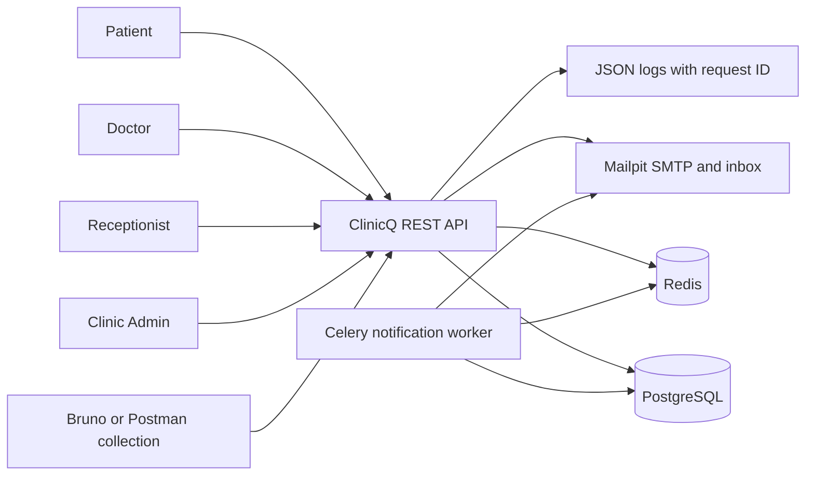
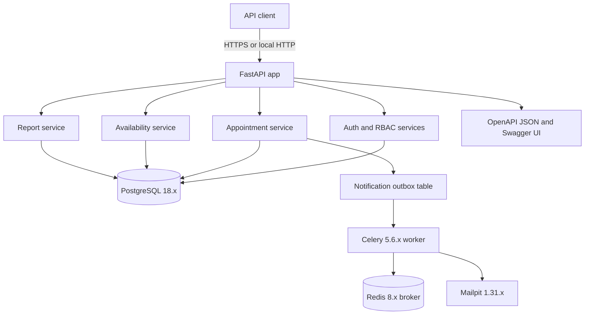
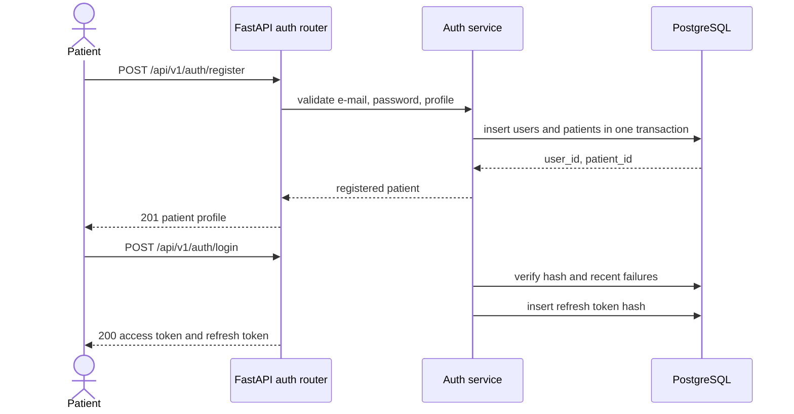
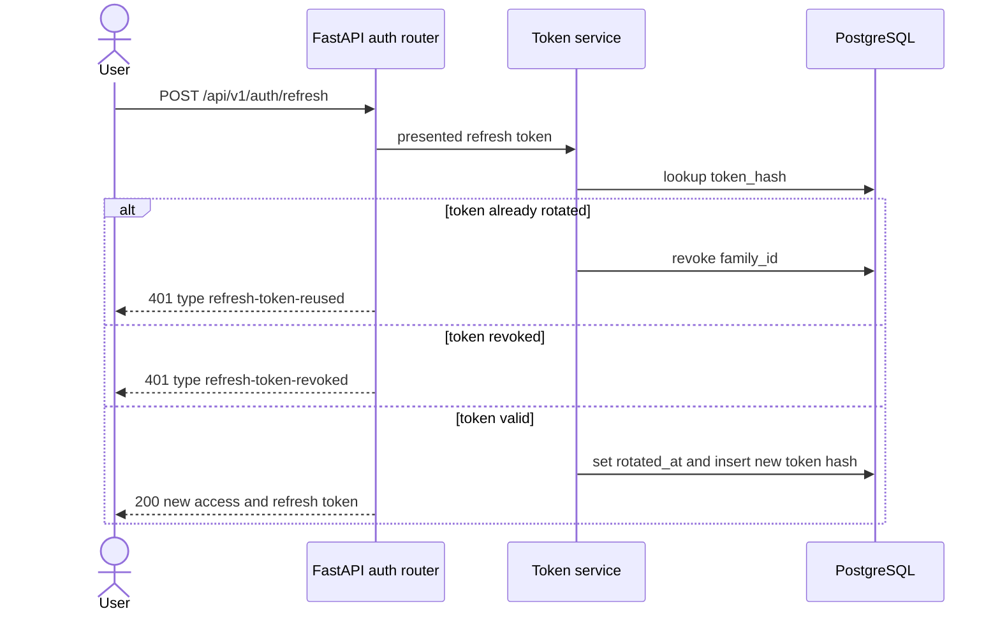
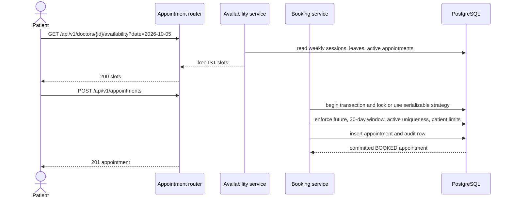
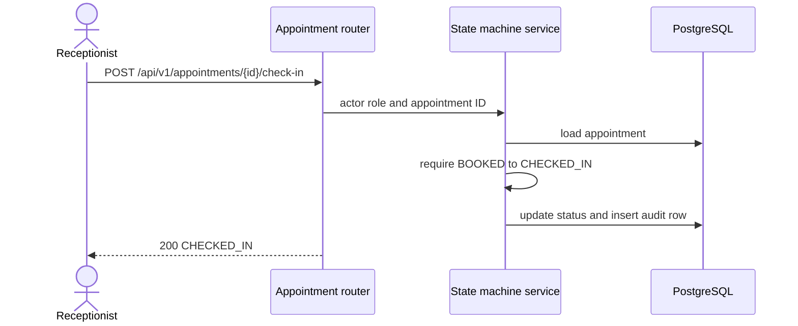
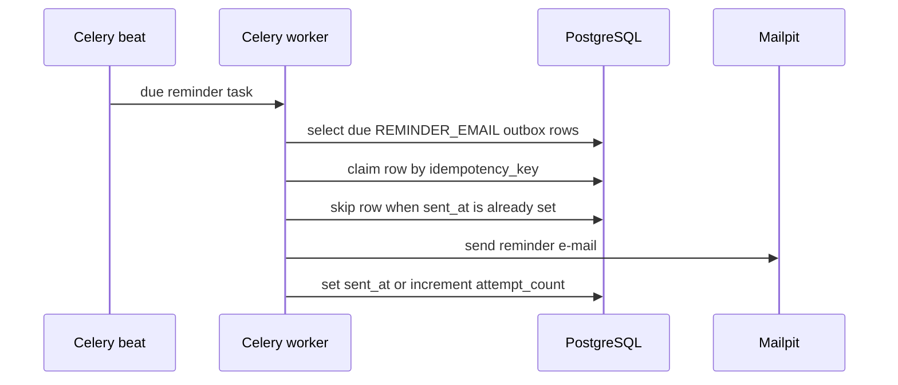

# System architecture

Purpose: This document defines the expected architecture for the `clinicq-api` student implementation.

## Context diagram



ClinicQ is a backend-only appointment booking API. Patients, doctors, receptionists, and admins use future clients or the demo API collection. The API owns authentication, role checks, booking rules, availability generation, and reports. PostgreSQL is the source of truth for users, doctors, schedules, leaves, appointments, audit logs, refresh tokens, login attempts, and notification outbox rows.

## Container diagram



The FastAPI app is layered: routers validate HTTP contracts, services enforce ClinicQ rules, repositories isolate SQLAlchemy queries, and models map PostgreSQL tables. The booking service MUST use database constraints, row locks, or `SERIALIZABLE` isolation with retry; an ADR must record the chosen strategy. The report service MUST use hand-written SQL for the doctor performance report.

## Key flow sequences

### Patient registration and login



### Refresh rotation with reuse detection



### Availability lookup and booking



### Receptionist state change



### Reminder e-mail worker (Should)



If SMTP succeeds and the worker crashes before `sent_at` is stored, a retry MAY send a duplicate e-mail. The outbox still keeps one reminder row per appointment.

## Data flow

1. HTTP requests enter through `/api/v1` routers with a request ID. Public health and auth endpoints skip bearer-token checks where documented.
2. Pydantic v2 request models validate JSON fields, ISO dates, UUIDs, pagination bounds, and enum values.
3. Auth dependencies verify JWT signatures, 15-minute expiry, active user state, and role permissions before service calls.
4. Services apply business rules from `BR-01` through `BR-31`. Appointment status changes always write `appointment_audit_log`.
5. SQLAlchemy repositories execute parameterized queries. The doctor performance report uses SQLAlchemy `text()` with bound parameters and a window function.
6. PostgreSQL stores timestamps in UTC. API response display fields use Asia/Kolkata offsets such as `2026-10-05T10:00:00+05:30`.
7. Errors leave the system as RFC 9457 Problem Details with stable `type` values.
8. JSON logs record request ID, method, path, status, duration, and authenticated user ID when present.

## Local deployment view

| Profile | Services | Resource target | Use |
|---|---|---:|---|
| Lite 8 GB | API, PostgreSQL, pytest runner | API 512 MB, PostgreSQL 512 MB | Mandatory Must-scope development and grading pre-check. Celery, Redis, Mailpit, and Locust are off. |
| Standard 16 GB | API, PostgreSQL, Redis, Celery worker, Mailpit, pytest runner, Locust | API 1 GB, PostgreSQL 1 GB, worker 512 MB | Full Must plus Should e-mail and performance testing. |

Docker Compose MUST pin images, including PostgreSQL 18.x, Redis 8.x, and Mailpit 1.31.x. A clean clone MUST start locally through documented `uv` and `docker compose` commands without paid services.

## Expected implementation repository tree

```text
clinicq-api/
  app/
    api/
      deps.py
      routers/
        auth.py
        doctors.py
        availability.py
        appointments.py
        reports.py
        health.py
    core/
      config.py
      logging.py
      security.py
      problem_details.py
    db/
      base.py
      session.py
      migrations/
    models/
    schemas/
    services/
      auth_service.py
      availability_service.py
      booking_service.py
      appointment_state_service.py
      report_service.py
      notification_service.py
    repositories/
    workers/
      celery_app.py
      reminder_tasks.py
  tests/
    unit/
    api/
    integration/
    concurrency/
    security/
    performance/
  docs/
    adr/
    query-plans/
  bruno/
  scripts/
    seed_demo.py
  docker-compose.yml
  docker-compose.lite.yml
  pyproject.toml
  uv.lock
  README.md
```

## Design principles

- Keep HTTP, service, repository, and model code separate so booking rules can be unit-tested without running FastAPI.
- Use PostgreSQL constraints and transactions for race-sensitive rules; do not rely only on Python in-memory checks.
- Make all configuration 12-factor environment variables with safe defaults in `.env.example`.
- Store only hashes for passwords and refresh tokens. Never log passwords, raw tokens, or Authorization headers.
- Prefer explicit Problem Details errors over framework-default JSON errors.
- Keep timestamps internally in UTC and convert to Asia/Kolkata only at API boundaries.
- Use an outbox table for notification side effects so appointment transactions do not depend on SMTP availability.

## Required ADR topics

| ADR topic | Exact question the student must answer |
|---|---|
| Booking transaction strategy | How does ClinicQ guarantee exactly one active appointment per doctor slot and patient limits under concurrent requests: partial unique indexes, row locks, `SERIALIZABLE` retry, or a combination? |
| Refresh token design | How are refresh tokens hashed, rotated, revoked on logout, and family-revoked when a rotated token is reused? |
| Availability query and indexes | Which query shape and indexes make availability fast for schedules, leaves, and active appointments, and what does `EXPLAIN ANALYZE` show? |
| Doctor performance report SQL | Why is the report implemented with hand-written SQL, how are parameters bound, and how is `revenue_rank` calculated with a window function? |
| Notification worker choice | If Should-scope e-mail is implemented, why are Celery, Redis, Mailpit, outbox rows, and idempotency keys used? |
| Deployment profile | Which Docker Compose profiles are supported on 8 GB and 16 GB hardware, and which services are disabled in the lite profile? |
| Optional technology choice | If async SQLAlchemy, Redis availability cache, Valkey, Schemathesis, or cloud deployment is chosen, what trade-off justifies it for ClinicQ? |

[Back to README](../README.md)
