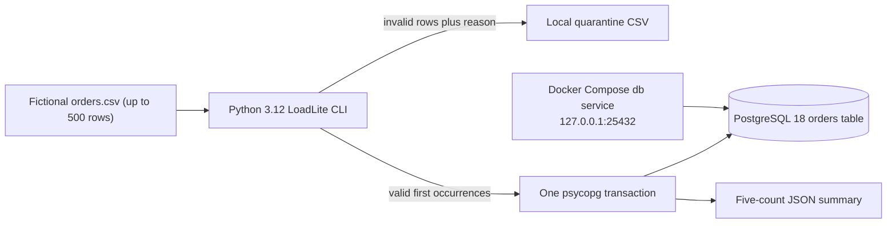

# System architecture

## Local architecture

## Data flow

1. Read the UTF-8 file, verify its exact header and row limit, and count source data rows.
2. Validate fields. Preserve invalid source values with a reason code. Keep the first valid occurrence of each source key.
3. Bind accepted values through psycopg and insert or update them in one transaction.
4. Commit the full batch, then report the exact counts. Any database failure rolls back the whole batch.

The CLI runs on the host. Compose runs only PostgreSQL; its only host-published port is `127.0.0.1:25432`. There is no second datastore or runtime integration.

## ADR questions

1. Why is one transaction appropriate for the 500-row maximum?
2. Why does a changed payload update the existing `order_id` instead of creating a second row?

[Back to README](../README.md)
