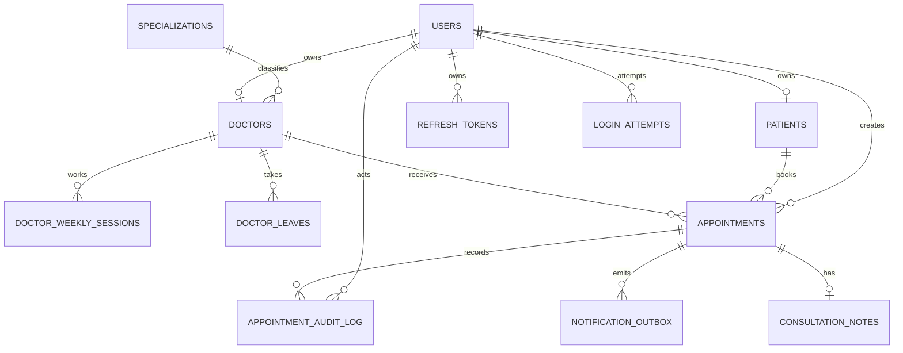

# Data model

Purpose: This document defines the logical ClinicQ data model, relationships, constraints, indexes, enumerations, samples, retention, and migration policy.

## Entity overview

ClinicQ stores users, patients, doctors, specializations, weekly sessions, leaves, appointments, audit log entries, refresh tokens, and login attempts. The model MUST support UTC storage, Asia/Kolkata display, active-only appointment uniqueness, refresh token rotation, lockout, and report queries.

## Tables and columns

### users

| Column | Logical type | Constraints | Description |
|---|---|---|---|
| id | uuid | Primary identifier | Stable user ID for login and audit. |
| email | string | Required and unique for login accounts | Lowercase e-mail address. |
| password_hash | string | Required | Argon2 or bcrypt hash. |
| role | enum | Required | `PATIENT`, `DOCTOR`, `RECEPTIONIST`, or `ADMIN`. |
| is_active | boolean | Required, default true | False blocks login and token use. |
| locked_until | timestamp | Nullable, UTC | End of lockout window after failed logins. |
| created_at | timestamp | Required, UTC | Account creation time. |
| updated_at | timestamp | Required, UTC | Last account update time. |

### patients

| Column | Logical type | Constraints | Description |
|---|---|---|---|
| id | uuid | Primary identifier | Patient profile ID. |
| user_id | uuid | Optional unique reference to users | Null only for Should-scope walk-in patients. |
| full_name | string | Required | Fictional patient display name. |
| phone | string | Required | Indian 10-digit phone number for booking calls. |
| date_of_birth | date | Optional | Used only if student chooses to collect it. |
| created_at | timestamp | Required, UTC | Profile creation time. |
| updated_at | timestamp | Required, UTC | Last profile update time. |

### specializations

| Column | Logical type | Constraints | Description |
|---|---|---|---|
| id | uuid | Primary identifier | Specialization ID. |
| name | string | Required and unique case-insensitive | Example: General Medicine. |
| active | boolean | Required, default true | Inactive values are hidden from new doctor setup. |
| created_at | timestamp | Required, UTC | Creation time. |

### doctors

| Column | Logical type | Constraints | Description |
|---|---|---|---|
| id | uuid | Primary identifier | Doctor profile ID. |
| user_id | uuid | Optional unique reference to users | Login account for the doctor. |
| specialization_id | uuid | Required reference to specializations | Search and reporting facet. |
| full_name | string | Required | Doctor display name. |
| consultation_fee_inr | decimal | Required, greater than or equal to 0 | Current consultation fee for new bookings. |
| slot_length_minutes | int | Required, MUST be 15 in Must scope | Should values can be 10, 15, 20, or 30. |
| active | boolean | Required, default true | Inactive doctors are excluded from new bookings. |
| created_at | timestamp | Required, UTC | Creation time. |
| updated_at | timestamp | Required, UTC | Last update time. |

### doctor_weekly_sessions

| Column | Logical type | Constraints | Description |
|---|---|---|---|
| id | uuid | Primary identifier | Weekly session ID. |
| doctor_id | uuid | Required reference to doctors | Doctor who works this session. |
| weekday | enum | Required | Monday through Sunday. |
| session_number | int | Required, 1 or 2 | Allows up to 2 sessions per weekday. |
| starts_at_local | time | Required | Local Asia/Kolkata start time. |
| ends_at_local | time | Required, after start | Local Asia/Kolkata end time. |
| active | boolean | Required, default true | Inactive sessions are ignored. |
| created_at | timestamp | Required, UTC | Creation time. |
| updated_at | timestamp | Required, UTC | Last update time. |

### doctor_leaves

| Column | Logical type | Constraints | Description |
|---|---|---|---|
| id | uuid | Primary identifier | Leave or holiday ID. |
| doctor_id | uuid | Required reference to doctors | Doctor unavailable during leave. |
| starts_at | timestamp | Required, UTC | Leave start instant. |
| ends_at | timestamp | Required, UTC and after start | Leave end instant. |
| reason | string | Required | Example: conference or clinic holiday. |
| created_by_user_id | uuid | Required reference to users | Admin who created the leave. |
| created_at | timestamp | Required, UTC | Creation time. |

### appointments

| Column | Logical type | Constraints | Description |
|---|---|---|---|
| id | uuid | Primary identifier | Appointment ID returned to clients. |
| doctor_id | uuid | Required reference to doctors | Doctor for the visit. |
| patient_id | uuid | Required reference to patients | Patient for the visit. |
| booked_by_user_id | uuid | Required reference to users | Patient, receptionist, or admin actor. |
| starts_at | timestamp | Required, UTC | Slot start instant. |
| ends_at | timestamp | Required, UTC and after start | Slot end instant. |
| local_date | date | Required, Asia/Kolkata | Date used for patient-doctor-date rule. |
| fee_at_booking_inr | decimal | Required, greater than or equal to 0 | Immutable doctor fee copied when the appointment is booked. |
| status | enum | Required | Appointment state. |
| cancellation_reason | string | Nullable | Required when status becomes `CANCELLED`. |
| no_show_reason | string | Nullable | Required when status becomes `NO_SHOW`. |
| created_at | timestamp | Required, UTC | Booking time. |
| updated_at | timestamp | Required, UTC | Last status or metadata update. |

### appointment_audit_log

| Column | Logical type | Constraints | Description |
|---|---|---|---|
| id | uuid | Primary identifier | Audit row ID. |
| appointment_id | uuid | Required reference to appointments | Changed appointment. |
| actor_user_id | uuid | Required reference to users | User who caused the change. |
| from_status | enum | Nullable for booking creation | Previous status. |
| to_status | enum | Required | New status. |
| reason | string | Nullable | Cancellation, no-show, or operational reason. |
| changed_at | timestamp | Required, UTC | Time of status change. |
| request_id | string | Required | Request ID from logs. |

### refresh_tokens

| Column | Logical type | Constraints | Description |
|---|---|---|---|
| id | uuid | Primary identifier | Refresh token record ID. |
| user_id | uuid | Required reference to users | Token owner. |
| token_hash | string | Required and unique | Hash of raw refresh token. |
| family_id | uuid | Required | Token family for reuse detection. |
| issued_at | timestamp | Required, UTC | Issue time. |
| expires_at | timestamp | Required, UTC | 7 days after issue. |
| rotated_at | timestamp | Nullable, UTC | Set when token is exchanged. |
| revoked_at | timestamp | Nullable, UTC | Set on logout or family revocation. |
| revoke_reason | string | Nullable | Example: logout or reuse detected. |

### login_attempts

| Column | Logical type | Constraints | Description |
|---|---|---|---|
| id | uuid | Primary identifier | Attempt row ID. |
| email | string | Required | Lowercase e-mail used for login. |
| user_id | uuid | Nullable reference to users | Null if e-mail does not exist. |
| success | boolean | Required | True only for successful login. |
| attempted_at | timestamp | Required, UTC | Attempt time. |
| ip_address | string | Optional | Client IP for audit and throttling review. |
| user_agent | string | Optional | User agent string. |

### notification_outbox (Should)

| Column | Logical type | Constraints | Description |
|---|---|---|---|
| id | uuid | Primary identifier | Outbox item ID. |
| appointment_id | uuid | Required reference to appointments | Appointment for e-mail. |
| event_type | enum | Required | `BOOKING_EMAIL`, `CANCELLATION_EMAIL`, or `REMINDER_EMAIL`. |
| idempotency_key | string | Required and unique | Allows one reminder outbox row for each appointment and skips sent rows. |
| due_at | timestamp | Required, UTC | Earliest send time. |
| sent_at | timestamp | Nullable, UTC | Send completion time. |
| attempt_count | int | Required, default 0 | Retry count. |

### consultation_notes (Should)

| Column | Logical type | Constraints | Description |
|---|---|---|---|
| id | uuid | Primary identifier | Note ID. |
| appointment_id | uuid | Required unique reference to appointments | One note set per appointment. |
| doctor_user_id | uuid | Required reference to users | Authoring doctor. |
| note_text | string | Optional | Short consultation note. |
| prescription_text | string | Optional | Short prescription text. |
| created_at | timestamp | Required, UTC | Creation time. |
| updated_at | timestamp | Required, UTC | Last update time. |

## Relationships

## Required constraints

| Requirement | Tables | Rule |
|---|---|---|
| Unique login e-mail | users | E-mail MUST be unique case-insensitively for login accounts. |
| Patient account link | patients | `user_id` MUST be unique when present. |
| Doctor account link | doctors | `user_id` MUST be unique when present. |
| Session count | doctor_weekly_sessions | One doctor can have only session numbers 1 and 2 per weekday. |
| Valid session time | doctor_weekly_sessions | `ends_at_local` MUST be after `starts_at_local`. |
| Valid leave time | doctor_leaves | `ends_at` MUST be after `starts_at`. |
| Valid appointment time | appointments | `ends_at` MUST be after `starts_at`. |
| Active-only slot uniqueness | appointments | For statuses `BOOKED` and `CHECKED_IN`, one doctor can have only one appointment at a start time. Cancelled and terminal statuses do not block reuse. |
| Patient-doctor-date limit | appointments | For active statuses, one patient can have only one appointment with the same doctor on one Asia/Kolkata date. |
| Upcoming patient limit | appointments | Service and transaction logic MUST enforce at most 3 upcoming active appointments per patient. |
| Refresh token secrecy | refresh_tokens | Store only token hash, never raw token. |
| Refresh reuse detection | refresh_tokens | A token with `rotated_at` or `revoked_at` MUST NOT be accepted. |
| Audit immutability | appointment_audit_log | Normal API endpoints MUST NOT update or delete audit rows. |
| Notification idempotency | notification_outbox | `idempotency_key` MUST be unique; reminder rows use one stable key per appointment. |

## Required indexes

These are requirements, not DDL.

| Index purpose | Table | Columns or expression | Reason |
|---|---|---|---|
| Login lookup | users | Lowercase e-mail | Fast login and uniqueness. |
| Patient profile lookup | patients | user_id | Resolve own appointments. |
| Doctor active search | doctors | active, specialization_id, lowercase full name | Search by role and filters. |
| Weekly schedule lookup | doctor_weekly_sessions | doctor_id, weekday, active | Availability generation. |
| Leave overlap lookup | doctor_leaves | doctor_id, starts_at, ends_at | Remove blocked slots. |
| Active slot uniqueness | appointments | doctor_id, starts_at where status is active | Prevent double booking. |
| Patient daily doctor limit | appointments | patient_id, doctor_id, local_date where status is active | Enforce one active appointment per doctor per date. |
| Patient upcoming active count | appointments | patient_id, starts_at where status is active | Enforce maximum 3 upcoming appointments. |
| Doctor day schedule | appointments | doctor_id, starts_at | Doctor and receptionist schedules. |
| Report date range | appointments | starts_at, doctor_id, status, fee_at_booking_inr | Doctor performance report revenue and counts. |
| Audit history | appointment_audit_log | appointment_id, changed_at | Appointment timeline. |
| Refresh token hash | refresh_tokens | token_hash | Refresh lookup. |
| Refresh family | refresh_tokens | family_id | Revoke token family on reuse. |
| Login lockout window | login_attempts | email, attempted_at | Count recent failures. |

## Enumerations

| Enum | Values |
|---|---|
| Role | `PATIENT`, `DOCTOR`, `RECEPTIONIST`, `ADMIN` |
| Appointment status | `BOOKED`, `CHECKED_IN`, `COMPLETED`, `CANCELLED`, `NO_SHOW` |
| Active appointment status | `BOOKED`, `CHECKED_IN` |
| Weekday | `MONDAY`, `TUESDAY`, `WEDNESDAY`, `THURSDAY`, `FRIDAY`, `SATURDAY`, `SUNDAY` |
| Sort option | `name_asc`, `fee_asc`, `fee_desc`, `next_available_asc` |
| Notification event | `BOOKING_EMAIL`, `CANCELLATION_EMAIL`, `REMINDER_EMAIL` |
| Problem type | `slot-already-booked`, `booking-limit-reached`, `patient-doctor-date-limit-reached`, `schedule-change-conflicts`, `refresh-token-reused`, `refresh-token-revoked` |

## Sample data

| Table | Example row |
|---|---|
| users | `asha.kulkarni@example.in`, role `PATIENT`, active true |
| patients | `Asha Kulkarni`, phone `9876543210`, linked to Asha user |
| specializations | `General Medicine`, active true |
| doctors | `Dr. Rohan Mehta`, `General Medicine`, fee `600.00`, slot length `15` |
| doctor_weekly_sessions | Monday session 1, `09:00` to `13:00` IST |
| doctor_weekly_sessions | Monday session 2, `17:00` to `20:00` IST |
| appointments | Dr. Rohan, Asha, starts `2026-10-05T04:30:00Z`, display `2026-10-05T10:00:00+05:30`, status `BOOKED` |
| appointment_audit_log | `BOOKED` to `CHECKED_IN`, actor `neha.patil@example.in`, UTC change time |

## Data retention

| Data | Retention rule |
|---|---|
| Users, patients, doctors | Keep for project lifetime unless local reset is requested. |
| Appointments | Keep for project lifetime to support past appointments and reports. |
| Appointment audit log | Keep for project lifetime and do not edit through normal API endpoints. |
| Refresh tokens | Delete or archive expired tokens after 30 days. |
| Login attempts | Keep at least 30 days for lockout and security review. |
| Notification outbox | Keep sent rows for at least 30 days in Should scope. |
| Seed data | May be reset in local development. |

## Migration policy

Every schema change MUST use an Alembic migration. Migrations MUST be reversible when practical. Seed data MUST be separate from migrations. The student MUST test migrations on an empty database and on a seeded database. Data migrations that modify appointments or audit rows MUST be described in an ADR or migration note.

## Time handling policy

All persisted timestamps MUST be UTC. API responses MAY include UTC fields and display fields with Asia/Kolkata offsets. Booking limits that depend on the calendar date MUST use the Asia/Kolkata local date. Slot generation MUST convert weekly local sessions to UTC instants before comparing leaves and appointments.

[Back to README](../README.md)
