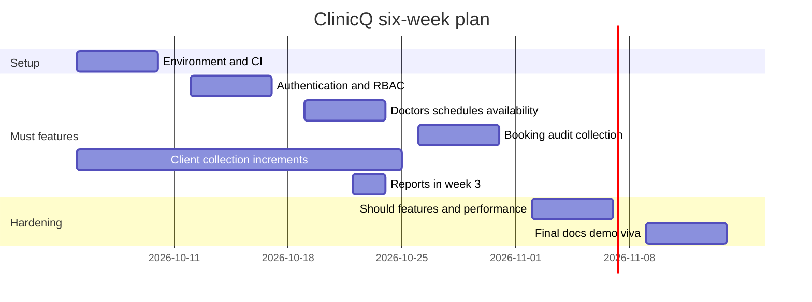

# Milestones and deliverables

Purpose: This document gives the 6-week ClinicQ work plan, effort budget, demo rhythm, final checklist, and demo script.

## Effort budget

Must work stays near 120 hours. The full project is about 180 hours.

| Feature area | Priority | Hours | Included FR IDs |
|---|---|---:|---|
| Guided learning and setup | Must | 30 | FR-OPS-01, FR-CLIENT-01 |
| Auth, tokens, lockout, RBAC | Must | 18 | FR-AUTH-01, FR-AUTH-02, FR-AUTH-03, FR-AUTH-04 |
| Doctor profiles, schedules, leaves | Must | 14 | FR-DOC-01, FR-DOC-02 |
| Availability and search | Must | 14 | FR-AVAIL-01, FR-SEARCH-01 |
| Booking rules and concurrency | Must | 16 | FR-BOOK-01, FR-BOOK-02 |
| Appointment state workflows | Must | 10 | FR-APPT-01, FR-APPT-02, FR-APPT-03, FR-APPT-04 |
| Audit, reports, logs, API standards | Must | 10 | FR-AUDIT-01, FR-REPORT-01, FR-API-01 |
| Must test hardening and demo collection | Must | 8 | FR-CLIENT-01, all Must FRs |
| Should notifications and extras | Should | 28 | FR-NOTIF-01, FR-NOTIF-02, FR-DOC-03, FR-PAT-01, FR-CLIN-01 |
| Performance, contract tests, documentation | Should/Could | 18 | FR-PERF-01, FR-TEST-01, FR-REPORT-02, FR-API-02 |
| Interview prep and contingency | Project | 14 | Viva, README, ADR review |
| **Total** |  | **180** |  |

## Week-by-week plan

| Week | Goals | Tasks with IDs | Deliverables | Friday demo checkpoint |
|---|---|---|---|---|
| 1 | Setup and first vertical slice | Learn FastAPI, uv, Docker, PostgreSQL. Create repo. Add CI skeleton. Implement `/api/v1/health/live`, `/api/v1/health/ready`, and seed start for FR-OPS-01. Start FR-CLIENT-01 with health smoke requests. Draft ADRs. | Clean clone starts. CI runs lint and tests. First migration exists. Collection has health requests. | Show health endpoint, database readiness, seeded doctors, and collection health smoke. |
| 2 | Authentication and staff access | Implement FR-AUTH-01, FR-AUTH-02, FR-AUTH-03, FR-AUTH-04. Add password hashing, 15-minute access token, 7-day refresh token, 5-failure lockout. Add auth and RBAC requests to FR-CLIENT-01. | Auth API tests, RBAC tests, and collection auth folder. | Register Asha, log in, lock account, refresh token, and show patient denied admin endpoint from the collection. |
| 3 | Clinic structure, availability, and reports | Implement FR-DOC-01, FR-DOC-02, FR-AVAIL-01, FR-SEARCH-01, and FR-REPORT-01. Add schedule conflict checks and required query plans. Add doctor, availability, and report requests to FR-CLIENT-01. | Doctor admin endpoints, availability endpoint, search tests, report test, report EXPLAIN ANALYZE note, and updated collection smoke. | Show Dr. Rohan schedule, a leave conflict 409, available slots in IST, report revenue rank, and collection smoke. |
| 4 | Booking and appointment workflows | Implement FR-BOOK-01, FR-BOOK-02, FR-APPT-01, FR-APPT-02, FR-APPT-03, FR-APPT-04, FR-AUDIT-01, and FR-CLIENT-01. Finish all Must FRs. | Concurrency tests, state tests, audit tests, and Bruno or Postman collection. | Run 10 same-slot requests and show exactly 1 booking. Then check in, complete, and show an audit row. |
| 5 | Should features and fixes | Add FR-NOTIF-01 or FR-NOTIF-02 if time allows. Close review findings, security gaps, and coverage gaps. | Mailpit demo if selected, stable CI, and updated README. | Show selected Should feature or a quality improvement with tests. |
| 6 | Hardening, documentation, viva | Close coverage gaps. Run Locust for FR-PERF-01 if selected. Prepare README, ADRs, demo video, and viva answers. | Final tag, coverage report, EXPLAIN ANALYZE notes, 5-minute video. | Full 10-minute final rehearsal and viva practice. |

## Gantt chart

## Final deliverables checklist

- Public GitHub repository named `clinicq-api`.
- Trainer `@sukurcf` added as collaborator.
- README with clean-clone setup in 10 steps or fewer.
- Architecture diagram and at least 5 ADRs.
- Alembic migrations and seed command for 5 doctors and 20 patients.
- Docker Compose with API, PostgreSQL, and Mailpit. Redis and Celery are included if reminders are selected.
- Bruno or Postman collection covering auth, search, availability, booking, state changes, conflict, report, and health.
- Seed schedules and demo appointment fixtures are relative to the actual run date. Fixed clocks are used only in automated tests.
- Test suite with at least 50 meaningful test cases.
- Coverage report proving total 85% line and 75% branch, service 95% line and 85% branch, auth 90% line and 80% branch, and report 85% line and 75% branch.
- Concurrency evidence for same-slot, patient-limit, and cancel-then-book cases.
- EXPLAIN ANALYZE notes for availability and doctor performance report.
- CI green on `main`.
- No secrets in history.
- Final tag `v1.0.0`.
- Demo video of maximum 5 minutes.

## Submission process

1. Freeze Must scope after week 4 unless a blocking bug remains.
2. Create a final PR named `release: prepare ClinicQ demo`.
3. Attach coverage, CI, collection, and query-plan evidence to the PR.
4. Merge only when CI is green.
5. Tag `v1.0.0` on `main`.
6. Submit the repository URL, final tag, demo video link, and Bruno or Postman collection path.
7. Keep the repository public until evaluation is complete.

## Ten-minute final demo script

| Minute | What to show | Evidence |
|---:|---|---|
| 0 | State the problem: Pune clinic has double bookings and paper queues. | One-sentence overview. |
| 1 | Show `/api/v1/health/live`, `/api/v1/health/ready`, and seeded data count. | FR-OPS-01 and BR-19. |
| 2 | Register Asha and log in. Show access token expiry of 900 seconds. | FR-AUTH-01 and FR-AUTH-02. |
| 3 | Show refresh rotation and a denied patient call to admin endpoint. | FR-AUTH-03 and FR-AUTH-04. |
| 4 | Search Dr. Rohan and request a free future slot within 30 days. | FR-SEARCH-01 and FR-AVAIL-01. |
| 5 | Book the selected future slot and show appointment status `BOOKED`. | FR-BOOK-01. |
| 6 | Run same-slot conflict request or test output: 1 success and 9 conflicts. | FR-BOOK-02 and NFR-REL-01. |
| 7 | Check in appointment and mark completed as doctor. | FR-APPT-01 and FR-APPT-04. |
| 8 | Show schedule-change conflict with affected appointment IDs. | FR-DOC-02 and BR-08. |
| 9 | Show doctor performance report, audit row, CI, and coverage report. | FR-REPORT-01, FR-AUDIT-01, and quality gates. |

If time remains, show Mailpit reminder or Locust report as optional Should evidence.

[Back to README](../README.md)
